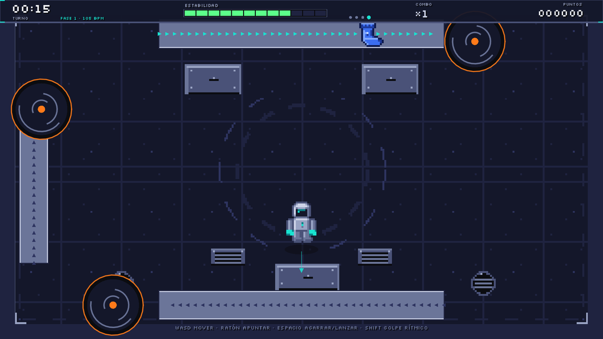
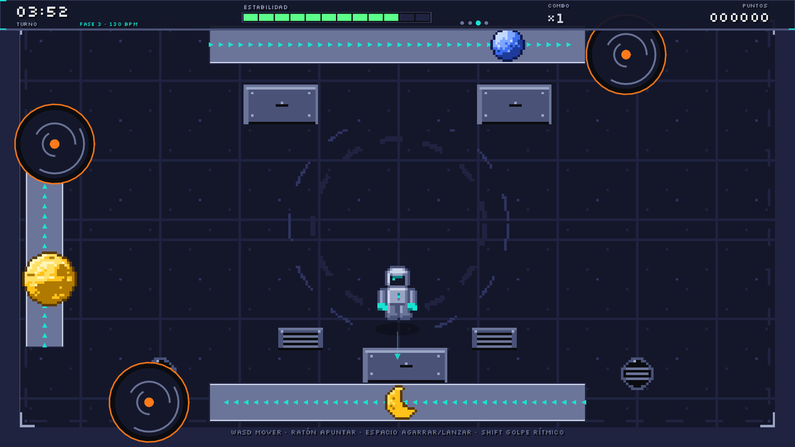

# Cosmic Spin Cycle

*Lavandería al Borde del Vacío* — a 2D pixel-art rhythm-arcade game for PC (Windows + Linux),
built with **Godot 4.7**.

You are Pip, the night-shift interdimensional janitor of an orbital laundromat. Catch dirty
celestial laundry off the conveyor belts, read its colour and pattern, and hurl it into the
right black-hole washing machine **on the beat** before the doors open at 06:00.




## What is playable (M0–M3)

- **Rhythm engine** — audio-locked beat clock, PERFECT/GOOD/MISS windows (±65/±130 ms),
  four tempo stems (105/118/130/142 BPM), a 10-second tap calibration wizard and a live
  beat-debug overlay.
- **Pip** — 8-way movement, magnetic grab/throw with grade-scaled impulses, a collision-safe
  120 px dash, a beat-graded rhythm strike, and five distinct item behaviours (heavy rocky,
  fast/skittish sock, boomerang moon, bouncy gas giant, gravity-field galaxy core).
- **The floor** — three conveyor belts with a pure 16-measure reversal schedule in phase 3,
  three vacuum shredders (−8 % stability each), deterministic phase-driven spawning
  (34/62/88/13 = 197 items over 480 s), the 480 s shift spine and a functional HUD.
- **Assets** — 29 CC0-sourced/adapted pixel-art sheets (176 frames), four CC0 music stems,
  nine CC0 SFX and the OFL Silkscreen font. See [`docs/PROVENANCE.md`](docs/PROVENANCE.md).

**Not in yet:** washing machines, the delivery chute, win/lose rules, title/pause/end
screens. Those are M4–M6 in [`AGENTS.md`](AGENTS.md); the walkable floor, spawner, physics and
audio spine they plug into are already integrated in `scripts/main/MainLevel.gd`.

## Run

```bash
godot --path .                     # play
./tools/dev.sh check               # import + tests + lint + format
./tools/verify_milestones.sh       # every gate, including art/audio/sim
./tools/dev.sh sim                 # headless 480 s spawn report
./tools/dev.sh shot                # screenshot the current level
```

On a headless box, point Godot user dirs at a writable path:

```bash
export XDG_DATA_HOME="$PWD/.work/xdg/data" XDG_CACHE_HOME="$PWD/.work/xdg/cache" \
       XDG_CONFIG_HOME="$PWD/.work/xdg/config"
```

## Controls

| Action | Keyboard / mouse | Gamepad |
|---|---|---|
| Move | WASD / arrows | left stick |
| Aim | mouse | right stick |
| Grab / throw | Space / left click | A / south |
| Rhythm strike (dash) | Shift / right click | B / east |
| Pause (M6) | Esc | Start |
| Beat debug overlay | F10 | Back |
| Debug cheats (M5) | F1–F4 | — |

## Verify

```
godot --headless --path . --import
godot --headless --path . -s addons/gut/gut_cmdln.gd -gdir=res://tests -ginclude_subdirs -gexit
gdlint scripts tests tools && gdformat --check scripts tests tools
python3 tools/lint_sprites.py && python3 tools/verify_audio.py
godot --headless --path . -s tools/sim_run.gd -- --seed=1234
```

Current state: **313 tests / 7,163 asserts green**, 29/29 sprite sheets pass the contract
linter, 16/16 audio checks pass, and the 480 s simulation reports exactly 197 spawns.

## Documentation

| File | Contents |
|---|---|
| [`docs/CONTRACTS.md`](docs/CONTRACTS.md) | frozen APIs, ownership, data layout, test policy |
| [`docs/DECISIONS.md`](docs/DECISIONS.md) | every deviation/default, numbered |
| [`docs/PROGRESS.md`](docs/PROGRESS.md) | milestone status, measurements, known issues |
| [`docs/GDD_TRACEABILITY.md`](docs/GDD_TRACEABILITY.md) | GDD & rubric → code → test matrix |
| [`docs/PROVENANCE.md`](docs/PROVENANCE.md) | every third-party asset, licence and transform |
| [`docs/AUDIO.md`](docs/AUDIO.md) | stems, bus plan, measurements |
| [`docs/CALIBRATION.md`](docs/CALIBRATION.md) | latency protocol and wizard |
| [`docs/HANDOFF.md`](docs/HANDOFF.md) | Track A/B integration anchors |
| [`docs/QA_CHECKLIST.md`](docs/QA_CHECKLIST.md) | human playtest checklist |
| [`docs/COMMITS.md`](docs/COMMITS.md) | commit policy (many small green commits) |

## Licensing

Code is MIT ([`LICENSE`](LICENSE)). Art, music, SFX and fonts are CC0 / OFL and are credited
in [`docs/PROVENANCE.md`](docs/PROVENANCE.md). No ads, IAP, telemetry, violence or mature
themes. The public GitHub remote is not configured in this checkout yet — the owner must
create the repository and push.

## Credits

Design source: *Cosmic Spin Cycle* GDD, Juan Camilo Valencia (Univalle). Music: HoliznaCC0
(*BASSIC*, CC0). SFX: rubberduck *100 CC0 SFX* and bretbernhoft *General Household Sound
Effects* (CC0). Art: adapted from Kenney CC0 packs (Planets, Roguelike/RPG, Pixel Platformer
Industrial Expansion), with authored fallbacks documented in PROVENANCE. Font: Silkscreen
(OFL 1.1, Jason Kottke / The Silkscreen Project Authors). Test framework: GUT (MIT).
