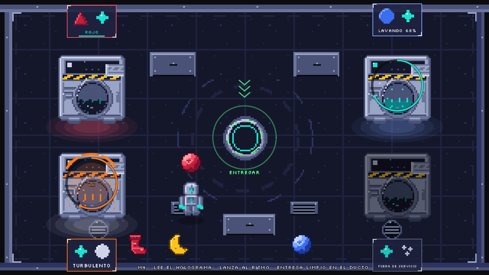

# M4 — Washers and the delivery chute

*Implementation note for the core loop (`ws/core-loop`). Player-facing copy is Spanish; every
symbol below is the real API the lead wires into `MainLevel`.*



*`scenes/dev/WasherSandbox.tscn` — NW idle + matching carry, NE washing, SW turbulent, SE
locked, centre chute carrying a clean item.*

---

## 1. What M4 adds

| File | Role |
|---|---|
| `scripts/logic/WasherFSM.gd` | Every washer rule, pure and deterministic |
| `scripts/logic/WasherAssignments.gd` | Phase → four `(requirement, locked)` rows + coverage |
| `scripts/logic/ScoreRules.gd` | Delivery points, S/A/B/C rank, end-screen summary |
| `scripts/logic/ShiftRules.gd` | Win/lose evaluation, Final Load kept as stats only |
| `scripts/entities/CosmicWasher.gd` + `.tscn` | Machine node: renderer + event forwarder |
| `scripts/environment/DeliveryChute.gd` + `.tscn` | The goal: clean-only delivery |
| `scenes/dev/WasherSandbox.gd` + `.tscn` | Dev/screenshot playground |
| `tests/unit/test_washer_fsm.gd` etc. | 64 new tests (suite total 379) |

## 2. WasherFSM

`extends RefCounted`, no scene, no autoload clock, no rendering. Time enters **only** through
`tick(dt)`; every rule input is an explicit call. That is what makes the whole loop
table-testable.

States: `IDLE → WASHING → (TURBULENT) → DONE`, and any state `→ BROKEN`, which repairs to
`IDLE` after `REPAIR_COOLDOWN_S` (6 s).

Mutators return a bool and queue events; `tick(dt)` advances time and returns the queue
(draining it); `take_events()` drains without advancing.

| Event | Payload | Meaning |
|---|---|---|
| `washing_started` | `cycle_time` | the drum started |
| `progress` | `progress`, `remaining`, `cycle` | one tick of wash progress |
| `turbulent` | `limit`, `reason` | entered TURBULENT (`cycle`/`accumulated`/`forced`) |
| `turbulence_resolved` | `grade` | a GOOD/PERFECT strike calmed it |
| `cycle_done` | `items` | the load is clean and collectable |
| `exploded` | `items`, `reason` | the drum collapsed (`turbulence`/`forced`) |
| `repaired` | — | usable again |

Rules as implemented (all covered by tests):

* **Capacity 3 slots.** `gas_giant` = 2, `galaxy_core` = 3 and a wildcard that needs an
  **empty** washer. `Compatibility.item_fits` decides colour/pattern requirements.
* **Cycle length** = `max(item.wash_s)` over the load, floored at
  `Config.MIN_WASH_TIME_S` (2 s); `Config.WASH_BASE_S` only for an empty explicit start.
* **Start** when the slots become full, or on an explicit rhythm strike with ≥ 1 item. No
  auto-timeout.
* **Beat reductions** (`PERFECT -3 s`, `GOOD -1 s`) apply once per throw. Before the cycle
  starts they are stored and consumed at `start_cycle`; while washing they hit `remaining`
  immediately. They never take `remaining` below 2 s and never *raise* a cycle that is
  already under the floor.
* **Turbulence** is 0..1; `≥ 1.0` enters TURBULENT. From phase index 2 (the GDD's phase 3)
  every 3rd cycle enters TURBULENT at 50 % progress (`AUTO_TURBULENCE_PHASE`). A MISS throw
  adds `Config.MISS_TURBULENCE_GAIN`. The limit is `min(5 s, 8 × beat)`.
* **Timeout** explodes; a strike of grade ≥ GOOD resolves (`RhythmEvaluator.resolves_turbulence`).
  During TURBULENT the wash keeps counting down but cannot complete until resolved.
* **DONE** waits `DONE_SETTLE_S` (0.35 s) before `collect()` releases the load, so the `done`
  animation can play.
* **BROKEN** clears the load (the event carries it) and auto-repairs after 6 s.

## 3. Washer assignments (the onboarding ramp)

| Phase | NW | NE | SW | SE |
|---|---|---|---|---|
| P1 (0–120 s) | `red` | `blue` | *locked* (`solid`) | *locked* (`spotted`) |
| P2 (120–270 s) | `red` | `blue` | `solid` | *locked* (`spotted`) |
| P3 (270–420 s) | `red` | `blue` | `solid` | `spotted` |
| P4 (420–480 s) | `yellow` | `red` | `solid` | `ringed` |

Locked rows are **pre-wired** with the requirement they will have when they unlock, so a
phase change only flips the lock. A locked washer never accepts and never costs stability.

### Known coverage gap (reported, not silently patched)

A requirement is a colour **or** a pattern, so four washers split 2 colours + 2 patterns cover
at most **8 of the 9** variants: the two colour washers take six, and the two pattern washers
can only reach the third colour in two of its three patterns.

* P3 leaves **`yellow_ringed`** without a home.
* P4 leaves **`blue_spotted`** without a home.

`WasherAssignments.coverage_ok(phase)` reports this honestly and
`uncovered_variants(phase)` names the orphans; `test_washer_assignments.gd` pins the exact
gap so a future fix updates both. Fix options for the lead (both outside this workstream's
ownership): restrict a phase's `allowed_patterns` per colour in the frozen `data/phases.tres`,
or make one washer per phase `wild`. Until then those two variants can be washed nowhere.

## 4. CosmicWasher node

Root `StaticBody2D` on `WASHER | WORLD` (**deviation:** the frozen player/item masks only
collide with `WORLD`, so the machine body carries both bits; masks are `0`). The root sits on
the mouth, so `mach_washer`'s bottom-centre pivot lands on the machine base.

Children after `_ready`: `Visual` (AnimatedSprite2D ×4, `centered=false`, `offset=-pivot`,
never rotated), `Holo` (procedural plaque + two `ui_holo_icons` glyphs + one text line),
`ProgressRing` (procedural arc around the drum), `Mouth` (Area2D, layer 0, mask ITEMS,
r = 60), `Audio` (`washer_drum` loop on SFX) plus three one-shot players, `SteamAnchor`.

**Holo anchors adapt to the frozen layout.** The north machines carry the panel 40 px above
them; the south row has only 64 world px between rows, so its panel is drawn 40 px **below**
the machine (`HOLO_ORIGIN_BELOW`). Colour is never the only channel: every state has a glyph
and Spanish text (`ROJO`, `NO COMPATIBLE`, `LAVANDO 64%`, `¡GOLPE!`, `LISTO`, `AVERIADA`,
`FUERA DE SERVICIO`). Locked machines dim the sprite to 55 % and drop their glow.

Side effects (the authority): wrong washer `-12` + `wrong_washer_count`; explosion `-25` +
`exploded_count`; each clean item `+1 washed_count`, guarded per instance. A locked washer and
a wildcard rejection never cost stability; a full washer is not "wrong" either.

## 5. DeliveryChute node

Root `Area2D` on `CHUTE`, mask `ITEMS`. Only `item.is_clean` delivers: `+3` stability,
`delivered_count += 1`, `score += item.points × combo` through `GameState.add_score`, chime,
`accept` animation, floating `+points` label, item freed. Dirty items bounce out with
`LAVA PRIMERO` for 1.2 s and **no** penalty. Delivery is guarded per instance id, so a double
callback cannot pay twice.

The beacon (rotating dashed ring + outer pulse + 3 chevrons + label) and the floating points
are procedural; the hatch is the shipped `env_chute` sheet, with palette rings as fallback.

## 6. Provisional constants (promote to `Config` when signed off)

`WasherFSM`: `DONE_SETTLE_S = 0.35`, `REPAIR_COOLDOWN_S = 6.0`, `AUTO_TURBULENCE_PHASE = 2`,
`AUTO_TURBULENCE_EVERY = 3`.
`CosmicWasher`: `MOUTH_RADIUS = 60`, `BODY_SIZE = (176,176)`, `BODY_CENTER = (0,-96)`,
`EJECT_OFFSET`, `EJECT_IMPULSE`, `EXPLODE_IMPULSE`, `BOUNCE_IMPULSE`, `REJECT_COOLDOWN_S = 0.6`,
`RELEASE_COOLDOWN_S = 0.4`, `HOLO_GAP = 40`, `HOLO_ORIGIN(_BELOW)`, `SHAKE_PX = 6`,
`SHAKE_TIME_S = 0.26`, `LOAD_FLASH_S = 0.18`, `ALARM_MAX = 3`, audio dB values.
`DeliveryChute`: `BEACON_RADIUS = 44`, `HINT_RADIUS = 84`, `HATCH_RADIUS = 64`,
`REJECT_LABEL_S = 1.2`, `ACCEPT_ANIM_S = 0.5`, `BOUNCE_IMPULSE = 340`.
`ScoreRules.REFERENCE_COMBO = 4` (the documented max-possible assumption).

## 7. Wiring checklist for the lead

```gdscript
# once, from layout.json (washers: rect + mouth in art px)
washer.configure(&"washer_nw", Rect2(36, 32, 48, 48), Vector2(60, 80), &"red")

# at a phase boundary
for row in WasherAssignments.table(phase):
    var w: CosmicWasher = washers[StringName(str(row["washer_id"]))]
    w.set_phase(phase)
    w.set_requirement(StringName(str(row["requirement"])))
    w.set_locked(bool(row["locked"]))

# per frame / on carry changes
washer.set_carry_hint(player.held_item)
player.struck.connect(func(w, grade): w.strike(grade))

# the chute
chute.configure(Rect2(144, 74, 32, 32), Vector2(160, 90))
chute.set_carry_hint(player.held_item)

# end screen
var summary := ScoreRules.summary(
    GameState.get_end_result(), ScoreRules.max_possible_score(schedule)
)
```

`MainLevel` still owns the HUD, the mission ribbon, the reticle and the end screen; the nodes
expose `get_glow_color()` for the lighting layer and `get_mouth_world()` for aiming.
